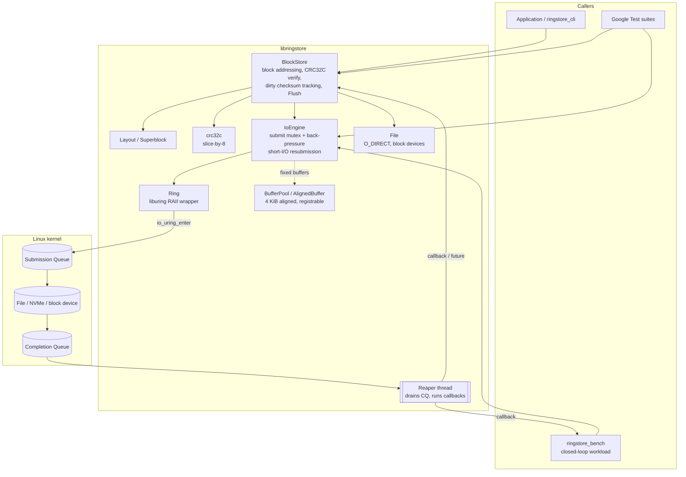
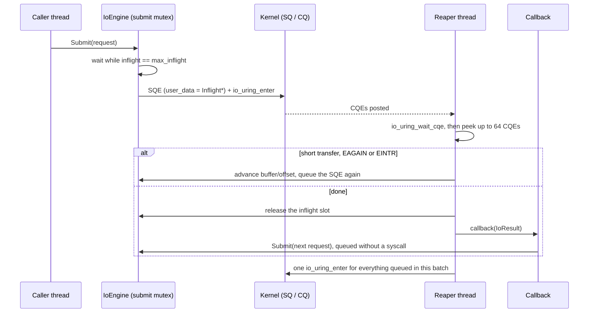

# RingStore

An asynchronous block storage engine in C++17, built on Linux **io_uring**.

RingStore sends every block read, write and fsync through one io_uring instance. A reaper
thread drains completions and hands them back through callbacks or futures. On top of that
engine sits a checksummed, fixed-size **block store** that works on a regular file or a raw
block device. A **benchmark tool** measures IOPS, throughput and tail latency across queue
depths and block sizes, and compares io_uring with a plain `pread`/`pwrite` baseline
([example output](#example-output)). The code is tested with **Google Test**.

## Features

- **`IoEngine`**: thread-safe submission with back-pressure at `max_inflight`, batched
  `io_uring_enter` calls, and automatic resubmission on short reads/writes and `EAGAIN`.
  Supports registered (fixed) buffers and files, optional `SQPOLL`, and a clean shutdown
  that drains in-flight I/O.
- **`BlockStore`**: superblock + CRC32C per block. Checksums are verified on read and
  persisted on `Flush()`. Supports multi-block contiguous I/O, `O_DIRECT`, and corruption
  detection with clear `Status` codes.
- **`ringstore_bench`**: closed-loop load generator that keeps exactly `qd` requests in flight.
  Supports random/sequential and read/write/mixed workloads. It reports p50/p99/p99.9 latency
  from a log-linear histogram and syscalls per op, and writes CSV output.
- **`ringstore_cli`**: format, inspect, fill, verify and scrub a store.

## Why io_uring

io_uring (Linux 5.1+) is built around two ring buffers that user space shares with the
kernel:

- **Submission queue (SQ).** The application writes Submission Queue Entries (SQEs), each
  describing one operation such as a read, write or fsync.
- **Completion queue (CQ).** The kernel posts a Completion Queue Entry (CQE) with the result
  of each operation, tagged with the SQE's `user_data`.

A single `io_uring_enter` call can hand the kernel any number of queued SQEs, and the
completions are read straight out of shared memory. Compared with one `pread`/`pwrite` per
I/O, this gives three things that matter for a storage engine:

- **Fewer syscalls.** With many requests in flight, one `io_uring_enter` covers a whole
  batch. `ringstore_bench` reports this as `sys/op`.
- **Real async file I/O without a thread per request.** epoll cannot wait on regular files,
  so the classic alternative is a thread pool of blocking calls. That is exactly what the
  `psync` baseline does, with one thread per unit of queue depth.
- **Less per-request kernel work, if you opt in.** Registered buffers and files skip some
  setup the kernel otherwise repeats for every I/O (see below).

### Registered buffers, registered files and SQPOLL

| Flag | What it does | Cost |
|---|---|---|
| `--fixed-bufs` | `BufferPool` buffers are registered once with `io_uring_register_buffers`. Requests then use `READ_FIXED`/`WRITE_FIXED`, and the kernel skips pinning and mapping the user pages on every I/O. | The pages stay pinned and count against `RLIMIT_MEMLOCK` on older kernels. |
| `--fixed-files` | The target fd is registered, so requests carry `IOSQE_FIXED_FILE` and the kernel skips the per-request fd lookup and reference count. | The fd is addressed by its index in the registered table, not its number. |
| `--sqpoll` | A kernel thread polls the SQ, so submitting usually needs no syscall at all. | That thread burns a CPU core while busy. It is privileged on kernels before 5.11. |

```
Without fixed buffers:  per I/O, pin user pages -> DMA -> unpin
With fixed buffers:     pin once at registration; per I/O, DMA straight into the pinned pages
```

With `O_DIRECT` both paths DMA straight into the user buffer. Registered buffers save the
per-request page pinning, not a copy, so expect a few percent at high queue depth rather
than a step change.

## Architecture



### On-disk layout

```
+-------------------+ 0
| superblock        |  magic "RINGSTR1", version, geometry, CRC32C (one block)
+-------------------+ block_size
| checksum region   |  4-byte CRC32C per data block, rounded up to whole blocks
+-------------------+ data_offset
| data region       |  num_blocks * block_size
+-------------------+
```

Checksums are stored apart from the data, so each block write is a single aligned I/O.
The checksum region is updated in memory when a write completes, and the dirty
checksum-region blocks are written back as coalesced runs on `Flush()`, followed by
`fdatasync`. A block that has never been written has no checksum and is returned
unverified.

### Request lifecycle



1. `Submit()` takes the submission mutex and waits while `inflight == max_inflight`. It then
   takes an SQE, fills it in, and sets `user_data` to a heap-allocated in-flight record. A
   submission from an ordinary thread calls `io_uring_submit` right away.
2. The reaper thread blocks in `io_uring_wait_cqe` and then collects up to 64 CQEs at once.
3. If a read or write transferred fewer bytes than requested, the request is moved forward by
   that amount and queued again. `EAGAIN`/`EINTR` are also retried, up to `max_resubmits`.
4. On completion the in-flight slot is released **before** the callback runs. That way a
   callback can chain the next request, which is what the benchmark's closed loop relies on.
   Requests queued from a callback, and resubmissions, are not sent one by one. The reaper
   submits all of them with a single `io_uring_enter` after it finishes the batch. This is
   where io_uring's syscall savings come from at high queue depth.
5. `Shutdown()` stops accepting work, waits for in-flight requests to drain, and then submits a
   sentinel NOP. When the reaper sees it, it exits.

## Requirements

- Linux kernel **5.6+** (5.10+ recommended) with io_uring enabled
- **liburing 2.0+** (`apt install liburing-dev` / `dnf install liburing-devel`)
- CMake 3.16+, a C++17 compiler (GCC 9+ / Clang 10+), `pkg-config`
- Internet access on the first configure (FetchContent downloads GoogleTest 1.14)
- Optional for plots: Python 3 with `pandas` and `matplotlib`

Notes:
- Docker's default seccomp profile blocks `io_uring_setup`. Run with
  `--security-opt seccomp=unconfined`, or use a VM or bare metal. If io_uring is unavailable,
  the tests skip themselves instead of failing.
- Registering fixed buffers counts against `RLIMIT_MEMLOCK` on older kernels. Raise it with
  `ulimit -l` if `--fixed-bufs` fails with `ENOMEM`.
- Benchmarking a raw block device such as `/dev/nvme0n1` needs root and **destroys its
  contents**.

No credentials or secrets are needed.

## Build

```bash
cmake -S . -B build -DCMAKE_BUILD_TYPE=Release
cmake --build build -j
```

CMake options: `-DRINGSTORE_BUILD_TESTS=OFF`, `-DRINGSTORE_BUILD_BENCH=OFF`,
`-DRINGSTORE_WERROR=ON`, `-DRINGSTORE_SANITIZE=ON` (ASan + UBSan).

Binaries produced in `build/`:

| Binary | Description |
|---|---|
| `ringstore_example` | Minimal walkthrough: writes 8 blocks through registered buffers, fsyncs, reads them back and prints engine stats |
| `ringstore_cli` | Format, inspect, fill, verify and scrub a block store |
| `ringstore_bench` | Closed-loop IOPS/latency benchmark, io_uring vs psync |
| `tests/ringstore_tests` | Google Test suites |

## Run

### Example program

```bash
./build/ringstore_example /tmp/ringstore_example.dat
# write errors=0 read mismatches=0 submitted=17 completed=17 syscalls=17
```

That is 8 writes, 1 fsync and 8 reads. Every request is submitted from the main thread
and waited on before the next phase starts, so each one costs its own `io_uring_enter`.
The benchmark below shows the opposite case, where chained requests share syscalls.

### Block store CLI

```bash
./build/ringstore_cli format /tmp/rs.img 262144        # 1 GiB of 4 KiB blocks
./build/ringstore_cli info   /tmp/rs.img
./build/ringstore_cli fill   /tmp/rs.img 1234          # deterministic pattern
./build/ringstore_cli verify /tmp/rs.img 1234          # compare contents + CRCs
./build/ringstore_cli scrub  /tmp/rs.img               # CRC-only pass
```

Example output for the commands above:

```
formatted /tmp/rs.img: 262144 blocks x 4096 bytes

block_size   4096
data_blocks  262144
csum_offset  4096 (256 blocks)
data_offset  1052672
total_bytes  1074794496
block_device no, O_DIRECT yes

fill complete: 262144 blocks, 0 problems
verify complete: 262144 blocks, 0 problems
scrub complete: 262144 blocks, 0 problems
```

The checksum region is 4 bytes per data block: 262144 × 4 B = 1 MiB = 256 blocks. It
starts right after the one-block superblock. `verify` and `scrub` print each bad range
to stderr and exit non-zero if anything is wrong. The store is opened with `O_DIRECT`, so
`/tmp` must be on a filesystem that supports it. If yours is an older tmpfs, use a path on
ext4 or xfs.

### Library usage

```cpp
ringstore::IoEngine engine;
engine.Start();                                      // 256-entry ring by default

ringstore::BlockStoreOptions opts;
opts.num_blocks = 1 << 18;                           // 1 GiB of 4 KiB blocks
std::unique_ptr<ringstore::BlockStore> store;
ringstore::BlockStore::Create("/data/rs.img", opts, &engine, &store);

ringstore::AlignedBuffer buf(opts.block_size);
store->WriteBlockAsync(42, buf.data(), [](const ringstore::Status& s) { /* ... */ });
store->ReadBlock(42, buf.data());                    // blocking; verifies CRC32C
store->Flush();
```

### Benchmarks

```bash
# Single sweep: 4 KiB random reads, qd 1..128, io_uring vs psync
./build/ringstore_bench --file /mnt/nvme/rs.dat --size 4g \
    --bs 4k --qd 1,4,16,64,128 --rw randread --time 10 --engine both

# Full matrix (randread / randwrite / 70:30 mixed x 4 block sizes x 8 queue depths)
scripts/run_sweep.sh /mnt/nvme/rs.dat 4g
python3 scripts/plot_results.py results/sweep.csv --out results/
```

Useful flags: `--fixed-bufs`, `--fixed-files`, `--sqpoll`, `--buffered` (turns off
O_DIRECT), `--ops N`, `--csv out.csv`. Point `--file` at a filesystem that supports
`O_DIRECT` (ext4/xfs on a real disk, not tmpfs). Otherwise use `--buffered`, and keep in mind
that the page cache will then dominate the results.

Output columns: `iops`, `MiB/s`, `avg/p50/p99/p999` latency in microseconds, and `sys/op`
(syscalls per I/O). `sys/op` shows how io_uring batching amortises `io_uring_enter`, compared
with exactly 1.0 for psync.

#### Example output

> **Illustrative, not a recorded run.** The numbers below are a conservative estimate for
> 4 KiB random reads with `O_DIRECT` against a mid-range PCIe 4.0 NVMe SSD on an 8-core
> machine. They show the output format and the trends to expect. Run the sweep on your own
> hardware for real numbers. NVMe drives differ by several times in random-read IOPS.

```
$ ./build/ringstore_bench --file /mnt/nvme/rs.dat --size 4g \
    --bs 4k --qd 1,4,16,64,128 --rw randread --time 10 --engine both
preparing /mnt/nvme/rs.dat (4294967296 bytes)...
engine    workload        bs    qd         iops      MiB/s    avg_us    p50_us    p99_us   p999_us   sys/op  errors
io_uring  randread      4096     1        11806       46.1      84.7      79.9     143.4     319.5    1.000       0
psync     randread      4096     1        12107       47.3      82.6      79.9     139.3     303.1    1.000       0
io_uring  randread      4096     4        44593      174.2      89.7      86.0     163.8     360.4    0.612       0
psync     randread      4096     4        43908      171.5      91.1      86.0     172.0     409.6    1.000       0
io_uring  randread      4096    16       158259      618.2     101.1      96.3     196.6     434.2    0.214       0
psync     randread      4096    16       149533      584.1     107.0     100.4     225.3     516.1    1.000       0
io_uring  randread      4096    64       412106     1609.8     155.3     147.5     303.1     622.6    0.071       0
psync     randread      4096    64       351070     1371.4     182.3     172.0     401.4     917.5    1.000       0
io_uring  randread      4096   128       498054     1945.5     257.0     241.7     491.5    1032.2    0.043       0
psync     randread      4096   128       388940     1519.3     329.1     311.3     720.9    1540.1    1.000       0

$ ./build/ringstore_bench --file /mnt/nvme/rs.dat --size 4g --no-prepare \
    --bs 4k --qd 64,128 --rw randread --time 10 --fixed-bufs --fixed-files
engine    workload        bs    qd         iops      MiB/s    avg_us    p50_us    p99_us   p999_us   sys/op  errors
io_uring  randread      4096    64       421607     1646.9     151.8     143.4     294.9     606.2    0.069       0
io_uring  randread      4096   128       512410     2001.6     249.8     237.6     475.1     983.0    0.042       0
```

| Queue depth | io_uring IOPS | psync IOPS | io_uring vs psync | io_uring p99 | psync p99 |
|---|---|---|---|---|---|
| 1 | 11.8k | 12.1k | 0.98x | 143 µs | 139 µs |
| 4 | 44.6k | 43.9k | 1.02x | 164 µs | 172 µs |
| 16 | 158k | 150k | 1.06x | 197 µs | 225 µs |
| 64 | 412k | 351k | 1.17x | 303 µs | 401 µs |
| 128 | 498k | 389k | 1.28x | 492 µs | 721 µs |

#### Reading the results

- **Queue depth 1 is a wash.** With one request in flight, both engines make one syscall
  per I/O and wait on the device. psync can come out slightly ahead because it skips the
  hand-off to the reaper thread. io_uring's advantage only appears once there is something
  to batch.
- **`sys/op` falls as queue depth rises.** At queue depth 128 the reaper usually finds
  20–25 completions waiting. It resubmits all of their follow-up reads with one
  `io_uring_enter`, so `sys/op` drops to about 0.04. psync stays at exactly 1.0 and adds
  128 threads' worth of context switches.
- **The gap shows up in the tail first.** At queue depth 64–128, p99 and p99.9 for psync
  climb faster than the mean, because threads queue for CPU time as well as for the device.
- **Little's law holds.** `iops ≈ qd / avg_us`. If a row breaks this badly, the device or
  the CPU, not the engine, is the bottleneck, or the warmup was too short.
- **Registered buffers and files are a modest win.** They add about 2–3% IOPS at high queue
  depth by skipping per-request page pinning and fd lookup. They are not a step change.

| Symptom | Likely cause | What to try |
|---|---|---|
| Numbers far above the drive's spec, latency in single-digit µs | Page cache. Either `--buffered`, or the file is on tmpfs | Drop `--buffered` and use ext4/xfs on the real device |
| Opening the target fails with `EINVAL` | Filesystem does not support `O_DIRECT` | Use ext4/xfs, or `--buffered` (and read results accordingly) |
| `--fixed-bufs` fails with `ENOMEM` | `RLIMIT_MEMLOCK` too low | `ulimit -l unlimited` or reduce queue depth |
| `io_uring_queue_init_params` fails with `EPERM` | Container seccomp profile | `--security-opt seccomp=unconfined`, or run on a VM or bare metal |
| IOPS flat from qd 16 upward | Device saturated, or one CPU core pegged by the reaper | Check `iostat -x` utilisation; shard across several engines |
| `sys/op` stuck near 1.0 at high qd | Completions trickling in one at a time (slow or throttled device) | Expected on HDDs and throttled cloud volumes |

## Test

```bash
cmake -S . -B build && cmake --build build -j
ctest --test-dir build --output-on-failure
# or run the binary directly with filters:
./build/tests/ringstore_tests --gtest_filter='BlockStore*'
```

By default the tests create scratch files in `/tmp`. If `/tmp` is tmpfs and you want the
O_DIRECT tests to run, set `RINGSTORE_TEST_DIR` to a directory on ext4 or xfs:

```bash
RINGSTORE_TEST_DIR=$HOME/scratch ctest --test-dir build --output-on-failure
```

Test coverage:

| Suite | What it checks |
|---|---|
| `AlignedBufferTest`, `BufferPoolTest` | alignment, move semantics, blocking acquire/release, iovec mapping |
| `Crc32cTest` | RFC 3720 vectors, incremental `Extend`, unaligned input |
| `RingTest` | init, NOP round trip with user_data, SQ exhaustion, opcode probe, buffer registration |
| `IoEngineTest` | read/write/fsync round trips, back-pressure past `max_inflight`, 8-thread stress, EOF short reads, kernel error propagation, shutdown drain, chained callbacks, fixed buffers + files |
| `LayoutTest`, `BlockStoreTest` | geometry, superblock CRC, persistence across reopen, bit-flip corruption detection, truncated files, 512 concurrent async writes, O_DIRECT alignment |
| `LatencyHistogramTest` | bucket bounds, monotonicity, percentile accuracy, merge |

## Project layout

```
include/ringstore/   public headers (status, aligned_buffer, buffer_pool, ring, file,
                     io_request, engine_options, io_engine, crc32c, layout, block_store)
src/                 library implementation
bench/               histogram, workload generator, ringstore_bench CLI
tools/               ringstore_cli
examples/            basic_io.cpp
tests/               Google Test suites
scripts/             run_sweep.sh, plot_results.py
```

## Limitations

- One ring per `IoEngine`. To scale across cores, create one engine per thread or shard.
- Concurrent writes to the same block, or a read racing a write to that block, are not
  ordered. Callers must serialise them.
- Data writes and checksum persistence are not atomic. After a crash, a block written after
  the last `Flush()` can read back as `Corruption`. This is deliberate: it is detected rather
  than returned silently.
- The on-disk format assumes a little-endian host (x86-64, aarch64).
