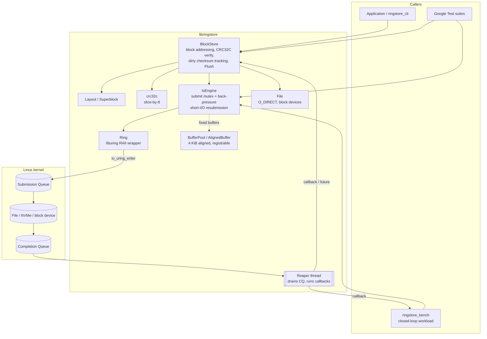

# RingStore

An asynchronous block storage engine in C++17, built on Linux **io_uring**.

RingStore sends every block read, write and fsync through one io_uring instance. A reaper
thread drains completions and hands them back through callbacks or futures. On top of that
engine sits a checksummed, fixed-size **block store** that works on a regular file or a raw
block device. A **benchmark tool** measures IOPS, throughput and tail latency across queue
depths and block sizes, and compares io_uring with a plain `pread`/`pwrite` baseline. The
code is tested with **Google Test**.

## Features

- **`IoEngine`**: thread-safe submission with back-pressure at `max_inflight`, batched
  `io_uring_enter` calls, and automatic resubmission on short reads/writes and `EAGAIN`.
  Supports registered (fixed) buffers and files, optional `SQPOLL`, and a clean shutdown
  that drains in-flight I/O.
- **`BlockStore`**: superblock + CRC32C per block. Checksums are verified on read and
  persisted on `Flush()`. Supports multi-block contiguous I/O, `O_DIRECT`, and corruption
  detection with clear `Status` codes.
- **`ringstore_bench`**: closed-loop load generator that keeps exactly `qd` requests in flight.
  Supports random/sequential and read/write/mixed workloads. It reports p50/p99/p99.9 latency
  from a log-linear histogram and syscalls per op, and writes CSV output.
- **`ringstore_cli`**: format, inspect, fill, verify and scrub a store.

## Architecture



### On-disk layout

```
+-------------------+ 0
| superblock        |  magic "RINGSTR1", version, geometry, CRC32C (one block)
+-------------------+ block_size
| checksum region   |  4-byte CRC32C per data block, rounded up to whole blocks
+-------------------+ data_offset
| data region       |  num_blocks * block_size
+-------------------+
```

Checksums are stored apart from the data, so each block write is a single aligned I/O.
The checksum region is updated in memory when a write completes, and the dirty
checksum-region blocks are written back as coalesced runs on `Flush()`, followed by
`fdatasync`. A block that has never been written has no checksum and is returned
unverified.

### Request lifecycle

1. `Submit()` takes the submission mutex and waits while `inflight == max_inflight`. It then
   takes an SQE, fills it in, sets `user_data` to a heap-allocated in-flight record, and calls
   `io_uring_submit`.
2. The reaper thread blocks in `io_uring_wait_cqe` and then collects up to 64 CQEs at once.
3. If a read or write transferred fewer bytes than requested, the request is moved forward by
   that amount and submitted again. `EAGAIN`/`EINTR` are also retried, up to `max_resubmits`.
4. On completion the in-flight slot is released **before** the callback runs. That way a
   callback can chain the next request, which is what the benchmark's closed loop relies on.
5. `Shutdown()` stops accepting work, waits for in-flight requests to drain, and then submits a
   sentinel NOP. When the reaper sees it, it exits.

## Requirements

- Linux kernel **5.6+** (5.10+ recommended) with io_uring enabled
- **liburing 2.0+** (`apt install liburing-dev` / `dnf install liburing-devel`)
- CMake 3.16+, a C++17 compiler (GCC 9+ / Clang 10+), `pkg-config`
- Internet access on the first configure (FetchContent downloads GoogleTest 1.14)
- Optional for plots: Python 3 with `pandas` and `matplotlib`

Notes:
- Docker's default seccomp profile blocks `io_uring_setup`. Run with
  `--security-opt seccomp=unconfined`, or use a VM or bare metal. If io_uring is unavailable,
  the tests skip themselves instead of failing.
- Registering fixed buffers counts against `RLIMIT_MEMLOCK` on older kernels. Raise it with
  `ulimit -l` if `--fixed-bufs` fails with `ENOMEM`.
- Benchmarking a raw block device such as `/dev/nvme0n1` needs root and **destroys its
  contents**.

No credentials or secrets are needed.

## Build

```bash
cmake -S . -B build -DCMAKE_BUILD_TYPE=Release
cmake --build build -j
```

CMake options: `-DRINGSTORE_BUILD_TESTS=OFF`, `-DRINGSTORE_BUILD_BENCH=OFF`,
`-DRINGSTORE_WERROR=ON`, `-DRINGSTORE_SANITIZE=ON` (ASan + UBSan).

## Run

### Example program

```bash
./build/ringstore_example /tmp/ringstore_example.dat
```

### Block store CLI

```bash
./build/ringstore_cli format /tmp/rs.img 262144        # 1 GiB of 4 KiB blocks
./build/ringstore_cli info   /tmp/rs.img
./build/ringstore_cli fill   /tmp/rs.img 1234          # deterministic pattern
./build/ringstore_cli verify /tmp/rs.img 1234          # compare contents + CRCs
./build/ringstore_cli scrub  /tmp/rs.img               # CRC-only pass
```

### Library usage

```cpp
ringstore::IoEngine engine;
engine.Start();                                      // 256-entry ring by default

ringstore::BlockStoreOptions opts;
opts.num_blocks = 1 << 18;                           // 1 GiB of 4 KiB blocks
std::unique_ptr<ringstore::BlockStore> store;
ringstore::BlockStore::Create("/data/rs.img", opts, &engine, &store);

ringstore::AlignedBuffer buf(opts.block_size);
store->WriteBlockAsync(42, buf.data(), [](const ringstore::Status& s) { /* ... */ });
store->ReadBlock(42, buf.data());                    // blocking; verifies CRC32C
store->Flush();
```

### Benchmarks

```bash
# Single sweep: 4 KiB random reads, qd 1..128, io_uring vs psync
./build/ringstore_bench --file /mnt/nvme/rs.dat --size 4g \
    --bs 4k --qd 1,4,16,64,128 --rw randread --time 10 --engine both

# Full matrix (randread / randwrite / 70:30 mixed x 4 block sizes x 8 queue depths)
scripts/run_sweep.sh /mnt/nvme/rs.dat 4g
python3 scripts/plot_results.py results/sweep.csv --out results/
```

Useful flags: `--fixed-bufs`, `--fixed-files`, `--sqpoll`, `--buffered` (turns off
O_DIRECT), `--ops N`, `--csv out.csv`. Point `--file` at a filesystem that supports
`O_DIRECT` (ext4/xfs on a real disk, not tmpfs). Otherwise use `--buffered`, and keep in mind
that the page cache will then dominate the results.

Output columns: `iops`, `MiB/s`, `avg/p50/p99/p999` latency in microseconds, and `sys/op`
(syscalls per I/O). `sys/op` shows how io_uring batching amortises `io_uring_enter`, compared
with exactly 1.0 for psync.

## Test

```bash
cmake -S . -B build && cmake --build build -j
ctest --test-dir build --output-on-failure
# or run the binary directly with filters:
./build/tests/ringstore_tests --gtest_filter='BlockStore*'
```

By default the tests create scratch files in `/tmp`. If `/tmp` is tmpfs and you want the
O_DIRECT tests to run, set `RINGSTORE_TEST_DIR` to a directory on ext4 or xfs:

```bash
RINGSTORE_TEST_DIR=$HOME/scratch ctest --test-dir build --output-on-failure
```

Test coverage:

| Suite | What it checks |
|---|---|
| `AlignedBufferTest`, `BufferPoolTest` | alignment, move semantics, blocking acquire/release, iovec mapping |
| `Crc32cTest` | RFC 3720 vectors, incremental `Extend`, unaligned input |
| `RingTest` | init, NOP round trip with user_data, SQ exhaustion, opcode probe, buffer registration |
| `IoEngineTest` | read/write/fsync round trips, back-pressure past `max_inflight`, 8-thread stress, EOF short reads, kernel error propagation, shutdown drain, chained callbacks, fixed buffers + files |
| `LayoutTest`, `BlockStoreTest` | geometry, superblock CRC, persistence across reopen, bit-flip corruption detection, truncated files, 512 concurrent async writes, O_DIRECT alignment |
| `LatencyHistogramTest` | bucket bounds, monotonicity, percentile accuracy, merge |

## Project layout

```
include/ringstore/   public headers (status, aligned_buffer, buffer_pool, ring, file,
                     io_request, engine_options, io_engine, crc32c, layout, block_store)
src/                 library implementation
bench/               histogram, workload generator, ringstore_bench CLI
tools/               ringstore_cli
examples/            basic_io.cpp
tests/               Google Test suites
scripts/             run_sweep.sh, plot_results.py
```

## Limitations

- One ring per `IoEngine`. To scale across cores, create one engine per thread or shard.
- Concurrent writes to the same block, or a read racing a write to that block, are not
  ordered. Callers must serialise them.
- Data writes and checksum persistence are not atomic. After a crash, a block written after
  the last `Flush()` can read back as `Corruption`. This is deliberate: it is detected rather
  than returned silently.
- The on-disk format assumes a little-endian host (x86-64, aarch64).
